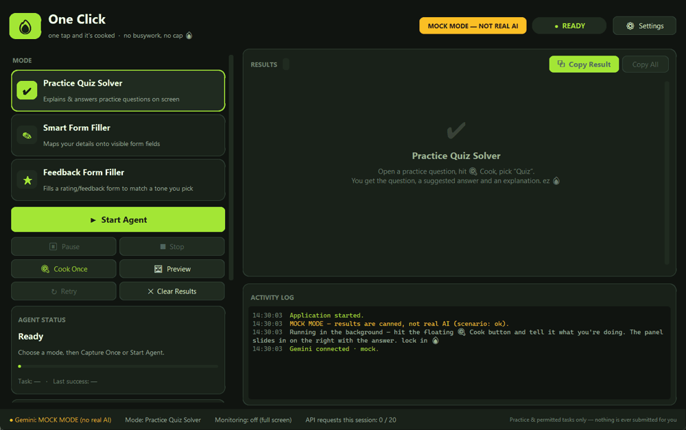

# 🔥 One Click — the one-tap agent

**One tap and it's cooked. No busywork, no cap. 🔥**



One Click is a Windows desktop AI agent. It starts hidden in the background with a small, movable floating **🍳 Cook** button. Hit Cook, tell it what you're doing (quiz / form / feedback), and it hides itself for a clean screenshot, sends it to Google Gemini (flash-lite, ~3–5s), validates the structured result, and slides the answer in as a right-docked sidebar. Any action — copying, typing, or selecting options — happens only after you confirm.

> Built for **practice** and **permitted** tasks only. It never submits anything for you. It flags screens that look like live graded or proctored tests and disables answer entry on them. A **Study-only** switch hides answers and gives hints instead.

---

## About the project

*One Click is a one-tap desktop AI agent that reads your screen to solve practice questions, fill forms, and auto-fill feedback surveys — fast, validated, and always under your control.*

One Click is a Windows desktop AI assistant that cuts repetitive screen work down to a single tap. It lives in the background behind a floating **🍳 Cook** button; press it, say what you're doing, and it grabs a clean screenshot (hiding itself first so it never blocks the content), sends it to Google Gemini **flash-lite** for ~3–5s responses, and shows a structured, validated result in a docked sidebar. It has three modes: a **Practice Quiz Solver** that explains and answers practice questions, a **Smart Form Filler** that fills forms using only the details you provide, and a **Feedback Form Filler** that reads a rating/survey form, picks the option matching a tone you choose, and can auto-fill the whole thing — selecting options and scrolling down until the form is done. In continuous mode it watches the screen and sends a request only when the content actually changes. It runs one request at a time and protects your API quota with request limits and automatic pausing. You stay in control: every answer is a reviewed suggestion, nothing is typed without your confirmation, forms are never submitted automatically, and sensitive fields like passwords are never filled. It's built in Python with CustomTkinter, the Gemini API and Pydantic validation, has 39 automated tests, and comes with full UML and data-flow design documentation.

---

## Features

| Mode | What it does |
|---|---|
| ✔ **Practice Quiz Solver** | Transcribes the question and its options, then gives a suggested answer, an explanation, and a confidence level. Study-only mode returns hints instead of answers. |
| ✎ **Smart Form Filler** | Finds the visible form fields and maps **only the details you typed** onto them. You review, edit, and tick each field before anything is entered. Nothing is ever submitted. |
| ★ **Feedback Form Filler** | Reads a rating/feedback/survey form on screen, picks the option matching a tone you choose (very good → very bad), and drafts comments. Auto-fill clicks the first option then uses arrow keys to land on your choice, typing comments and scrolling down until the form ends. You verify before submitting — nothing is submitted for you. |

**One-Click engine** (shared by all modes)
- **🍳 Cook** (floating button → pick quiz / form / feedback) or **continuous monitoring** (Start / Pause / Resume / Stop)
- **Starts hidden** behind a small, movable, always-on-top Cook button; answers open as a **right-docked sidebar**, and the full app opens maximized for setup.
- **Hides itself for a clean capture** instead of blacking out its own window, so the content underneath is never obscured.
- **Fast model**: defaults to Gemini **flash-lite** with minimal thinking (~3–5s responses).
- **Local screen-change detection**, so an unchanged screen is never re-uploaded. It uses a downscaled, quantized grayscale grid, which ignores cursor movement, plus a settle/debounce timer.
- Only **one in-flight request** at a time. Each task gets an ID, and results that arrive after Stop or a restart are **discarded as stale**.
- **Region selection** (drag a rectangle), and **Preview** to see exactly what would be sent
- **Pydantic validation** of every AI response. Malformed output is rejected and you get a Retry option.
- **Readable error categories**: rate limit/quota, auth, model not found, timeout, network, server, empty, malformed, screenshot, automation
- **Quota protection** (free-tier keys have small daily limits):
  - After a quota/rate-limit error, **no request is sent** until Gemini's reset time. Retry is refused locally, and the wait is shown in plain units (e.g. "~19.0 h").
  - A **per-session request budget** (default 20). The agent pauses when it's used up.
  - In continuous mode, **at most one request every 20 s**, and only for changes larger than 2% of the screen.
  - **One automatic retry** for transient overload (503/504); otherwise use Retry manually.
- A timestamped **activity log**. API keys and e-mail addresses are redacted, and no screenshots or form values are logged.
- A footer showing Gemini connection status, mode, monitoring state, and the API request count

## Architecture

```
main.py                      entry point + dependency check
app/
  ui.py                      CustomTkinter UI (widgets only; drains an event queue)
  theme.py                   design tokens (colours, fonts, button styles)
  agent_controller.py        state machine, workers, de-dup, stale-result protection
  screenshot_service.py      capture, region clipping, hide-for-clean-capture, validation, JPEG prep
  screen_change_detector.py  local change detection + debounce
  gemini_service.py          google-genai client, timeouts, retries, request counter, MOCK
  modes.py                   mode registry (prompt + schema + post-processing + copy)
  practice_mode.py / form_mode.py / feedback_mode.py   prompts and per-mode rules
  response_models.py         Pydantic schemas + safe parsing
  automation_service.py      allow-listed actions (copy, paste-into-focused, Tab, click+arrow)
  error_handler.py           error categories + exception translation
  activity_logger.py         thread-safe log with redaction
  config.py                  .env + settings.json
tests/                       unit tests with a mocked Gemini service (no network, no quota)
demo/                        local practice page, sample form, sample texts
```

Background threads never touch widgets. They post `AgentEvent`s to a queue, and the UI drains it on the Tk main loop.

AI output can never trigger arbitrary actions. The only desktop actions are clipboard copy, pasting a value into the field **you** focused, pressing Tab, and — for the feedback auto-fill you approve — clicking an option and pressing arrow keys. Every one runs after an explicit confirmation, and the mouse fail-safe (slam to a screen corner) aborts instantly.

## Design documentation

The full set of design diagrams is in [`docs/`](docs/README.md): the agent orchestrator, data flow diagrams (levels 0–2), the use case diagram, system sequence diagrams (SSD), sequence diagrams (SD), the UML class diagram, the state machine, activity diagrams, and component & deployment diagrams. GitHub renders them inline, and pre-rendered SVGs are in [`docs/images/`](docs/images/).

## Requirements

- Windows 10/11 (macOS/Linux mostly work; window-focus checks are Windows-oriented)
- Python **3.11+** (tested on 3.14)
- A Gemini API key from https://aistudio.google.com/apikey

## Quick start (Windows)

**Option A: double-click `run.bat`.** On first run it creates the virtual environment, installs dependencies, and opens Notepad so you can paste your `GEMINI_API_KEY` into `.env`. After that it launches the app with no console window. Later runs start instantly.

**Option B: standalone `One-Click.exe`** (no Python needed on the target PC):

```powershell
build_exe.bat          # produces dist\One-Click.exe (~37 MB)
```

Put a `.env` file containing `GEMINI_API_KEY` **next to `One-Click.exe`**. `build_exe.bat` copies your local `.env` there automatically. Settings and logs are also stored next to the exe.

## Setup (Windows PowerShell)

```powershell
cd cheater-exe
python -m venv .venv
.venv\Scripts\Activate.ps1
pip install -r requirements.txt
copy .env.example .env
notepad .env        # set GEMINI_API_KEY (and optionally GEMINI_MODEL)
python main.py
```

If PowerShell blocks activation, run `Set-ExecutionPolicy -Scope CurrentUser RemoteSigned` once, or skip activation and run `.venv\Scripts\python main.py`.

### Environment variables (`.env`)

| Variable | Required | Default | Notes |
|---|---|---|---|
| `GEMINI_API_KEY` | yes | – | Never committed (`.env` is git-ignored) and never logged |
| `GEMINI_MODEL` | no | `gemini-3.5-flash-lite` | Any image-capable model available to your key. flash-lite is fastest (~3–5s); `gemini-3.8-flash` works but is far slower (~80s). |
| `GEMINI_THINKING_LEVEL` | no | `minimal` | `minimal`/`low`/`medium`/`high` (Gemini 3.x). Lower is faster. flash-lite supports `minimal`; `gemini-3.8-flash` does not (use `low` there). |
| `CHEATER_MOCK_MODE` | no | off | `1` = canned responses, clearly labelled **MOCK — NOT REAL AI** |
| `CHEATER_MOCK_SCENARIO` | no | `ok` | `rate_limit`, `timeout`, `malformed`: for demoing error handling |

Agent tuning (monitor interval, change sensitivity, settle time, max image size, timeout, retries, minimum gap between requests, session request budget) lives under **⚙ Settings** and is saved to `settings.json`.

## How to use

The app starts hidden with the floating **🍳 Cook** button. Open the content you want, hit **Cook**, and pick the task.

1. **Quiz:** open `demo/practice_question.html` in a browser. Hit **🍳 Cook → Quiz**. One Click hides itself, grabs a clean screenshot, and the sidebar shows the detected question, a suggested answer, confidence, and an explanation. Use **Copy**. For a hands-free run, open the panel (**▦**) and click **Start Agent** — only the changed screen gets analyzed.
2. **Form:** open `demo/sample_form.html`. Open the panel (**▦**), paste `demo/my_details_example.txt` into **Your details**, then **🍳 Cook → Form**. Review each row: edit values and tick the fields to fill. Confident, user-sourced values are pre-ticked; uncertain and sensitive fields (like passwords) are not. Click **Fill ticked fields** and click into the first field during the countdown. The form is never submitted.
3. **Feedback:** open a rating/feedback/survey form. Hit **🍳 Cook → Feedback** and pick a **tone** (very good → very bad). One Click selects the matching option for each question, drafts comments, and can **auto-fill** the whole form — clicking the first option, pressing arrow keys to your choice, and scrolling down until the form ends. Review every answer before you submit.
4. **Error handling demo:** set `CHEATER_MOCK_MODE=1` and `CHEATER_MOCK_SCENARIO=rate_limit` (or `malformed`). Cook once to see the readable error, the paused agent, and the Retry button, while the UI stays responsive.

**Saving quota:** **Start Agent** sends the current screen right away, then only real changes. Prefer a single **Cook** when you just need one answer, and select a region so unrelated activity (chat apps, videos, clocks) can't trigger requests.

**Tips:** use **Select Region** to send less of your screen; it's faster and more private. One Click hides itself during capture, so you no longer need to move it off the content. To abort typing or auto-fill, press **Stop** or slam the mouse into a screen corner (PyAutoGUI fail-safe).

## Privacy & safety

- Screenshots are sent to Google Gemini **only when a task runs**. They live in memory only and are never written to disk. **Clear Results** discards them.
- The activity log contains short event descriptions only. Keys and e-mail addresses are redacted.
- The form filler never invents personal data. Deterministic guards strip any name, e-mail, phone, or date the model didn't get from you, and passwords, cards, IDs, OTPs, and CAPTCHAs are never filled.
- Text in screenshots is treated as untrusted data. Prompts tell the model to ignore instructions embedded in the screen.
- Nothing is ever submitted automatically, and there are no hidden or stealth modes.

## Tests

```powershell
.venv\Scripts\python -m pytest -q
```

The tests cover change detection (identical screens, real changes, cursor movement, resolution change), response validation (malformed, missing, or invalid fields), form safety (uncertain and sensitive fields not auto-filled), error translation (429, 401, 404, 503, timeout), missing configuration, and controller behaviour: duplicate Start, Stop, Pause/Resume, stale results, rate-limit pause, retry, and de-duplication. Gemini is mocked in all of them.

## Known limitations

- Captures the **primary monitor** only.
- Form filling relies on the page's **Tab order**. Sequential fill stops before selects, radios, and checkboxes, which you fill by hand. "Entered" means the keystrokes were sent; check the result on screen.
- Feedback auto-fill selects options with **click + arrow keys**, which works on keyboard-navigable radio groups (web forms like Google Forms). Unusual custom widgets may differ — always verify before submitting.
- An already-sent Gemini request can't be recalled. After Stop its result is discarded.
- Response time depends on Gemini load. flash-lite is fastest; a smaller capture region also helps.

## Troubleshooting

| Symptom | Fix |
|---|---|
| "GEMINI_API_KEY is not set" | Create `.env` from `.env.example`, then restart |
| "model was not found" | Set `GEMINI_MODEL` to a model your key can use (e.g. `gemini-3.5-flash-lite`) |
| Rate limit / quota | The app blocks requests until the reset time it shows. For a daily limit, either wait, switch `GEMINI_MODEL` to another model (quotas are usually per model), or use a key with billing. Check usage in AI Studio |
| "Session limit … reached" | The per-session budget protects your quota. Raise it in ⚙ Settings or restart the app |
| Timeouts / 503 / 504 | Gemini is overloaded or the network is slow. Retry, capture a smaller region, or raise the timeout in Settings |
| "The capture is blank" | Select a region that contains the question/form/text (One Click already hides itself during capture) |
| Nothing typed | Click into the target field during the countdown. One Click refuses to type into itself |
| `Missing dependencies` | `pip install -r requirements.txt` inside the venv |
