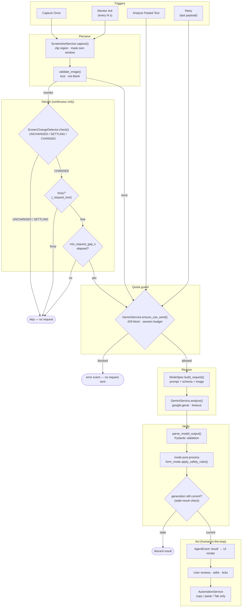
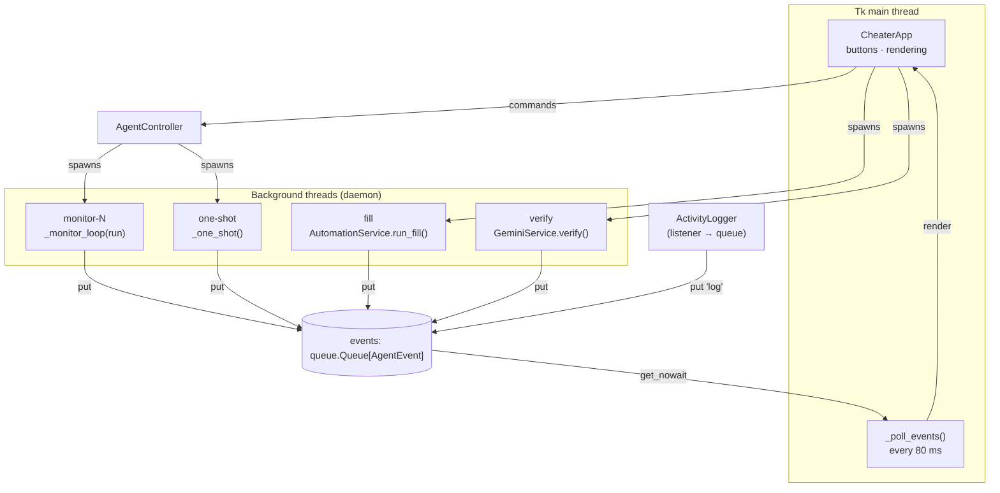
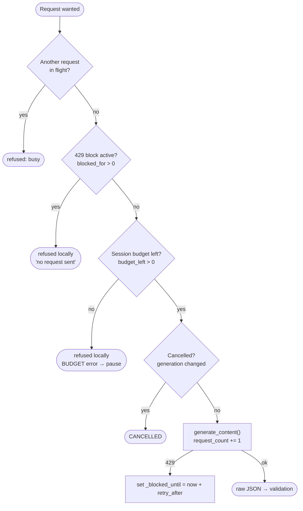

# 1. Agent Orchestrator

`AgentController` (`app/agent_controller.py`) is the orchestrator. It owns the agent's state machine, decides **when** work happens, and coordinates every other component. It never touches widgets. Its only output to the UI is `AgentEvent` objects on a queue.

## 1.1 Orchestration pipeline

Each task passes through this pipeline. The guards are filters: a task that fails one of them stops there and **costs no API quota**.

## 1.2 Responsibilities of the orchestrator

| Concern | How `AgentController` handles it |
|---|---|
| **Lifecycle** | `start()`, `pause()`, `resume()`, `stop()`, `capture_once()`, `analyze_text()`, `retry()`, `clear()`, `shutdown()` |
| **State** | Explicit `AgentState` machine; `_transition()` rejects invalid moves (see [State Machine](07-state-diagram.md)) |
| **One request at a time** | Non-blocking `_request_lock`. A second request is refused, never queued. |
| **No duplicate workers** | `start()` refuses while `monitoring`. Each run gets its own `_Run` (stop/resume events), so a stopped run can never be revived. |
| **Stale results** | `_generation` is incremented on Stop/Start. A result whose generation no longer matches is discarded. |
| **Quota protection** | `ensure_can_send()` before every request. Continuous mode adds `min_request_gap_s` and change detection. It pauses on `RATE_LIMIT`, `BUDGET`, `AUTH` and `CONFIG` errors. |
| **Review gate** | Form mode (`pause_for_review=True`) moves to `WAITING_FOR_REVIEW` after each result |
| **Recovery** | Errors become `AgentError` (category, message, hint). The last payload is kept in memory so the user can Retry. |

## 1.3 Thread & event model

Background threads **never** touch Tk widgets. Everything crosses to the UI through one `queue.Queue` of `AgentEvent`s, which the UI drains every 80 ms in `_poll_events()`.

### Event kinds

| `AgentEvent.kind` | Producer | UI reaction |
|---|---|---|
| `state` | `_transition()` | Status pill, status card, enable/disable controls |
| `task` | `_run_analysis()` | Current task number, hide error banner |
| `result` | `_run_analysis()` | Render the mode's result view (MOCK badge if mock) |
| `error` | `_report_error()` | Error banner with category, message, hint, Retry |
| `capture` | capture paths | Keep the last image for Preview |
| `counter` | `_run_analysis()` | Footer "API requests N / budget" |
| `log` | `ActivityLogger` listener | Append a colored line to the activity log |
| `verify` | startup thread | Footer Gemini connection status |
| `preview` | Preview button thread | Open the screenshot preview window |
| `fill_progress` / `fill_done` | fill thread | Status text / fill report |

## 1.4 Guard chain before any API call

