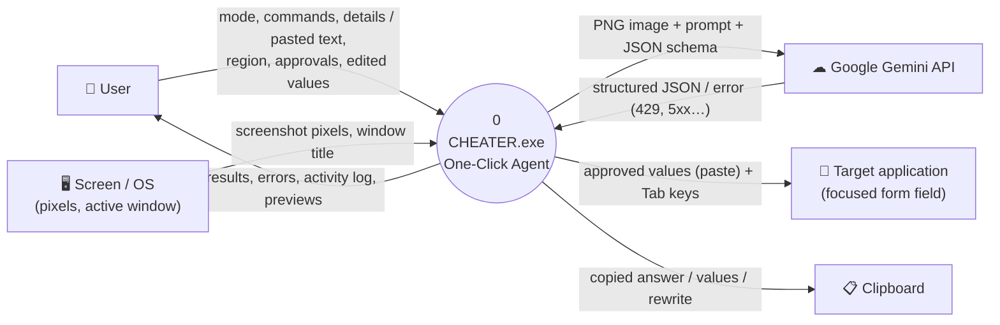
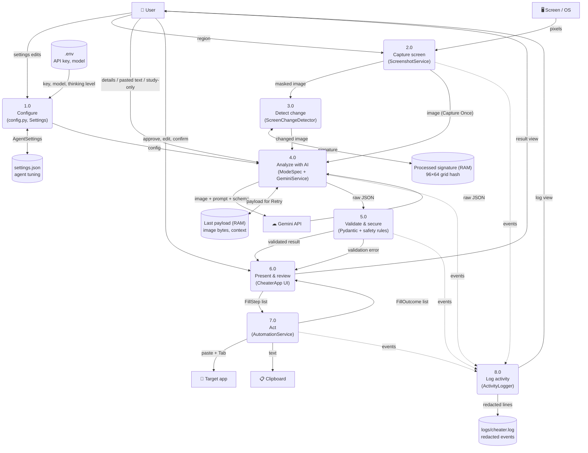
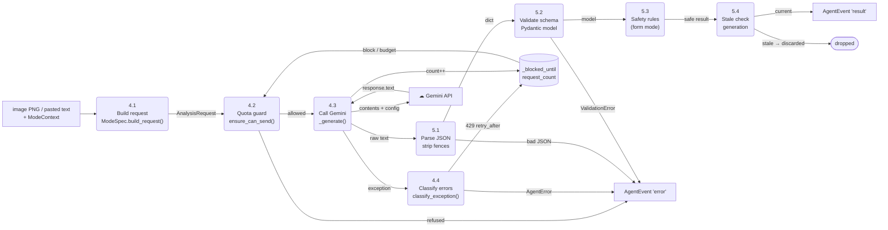

# 2. Data Flow Diagrams (DFD)

The notation follows Gane–Sarson / Yourdon conventions, drawn in Mermaid:

- **Rectangles**: external entities
- **Rounded boxes**: processes, numbered
- **Cylinders**: data stores
- **Arrows**: data flows, labelled with the data that moves

## 2.1 Level 0 — Context diagram

The whole system is one process. Screenshots leave the machine **only** in the flow to the Gemini API.

## 2.2 Level 1 — Main processes

**Privacy properties visible in this DFD**
- D3 and D4 exist **only in memory**. No screenshot is ever written to disk. *Clear Results* drops D3.
- D5 receives only redacted event text: no images, form values, API keys or e-mail addresses.
- D1 (`.env`) is read once and is git-ignored.

## 2.3 Level 2 — Process 4.0 "Analyze with AI" (with 5.0)

