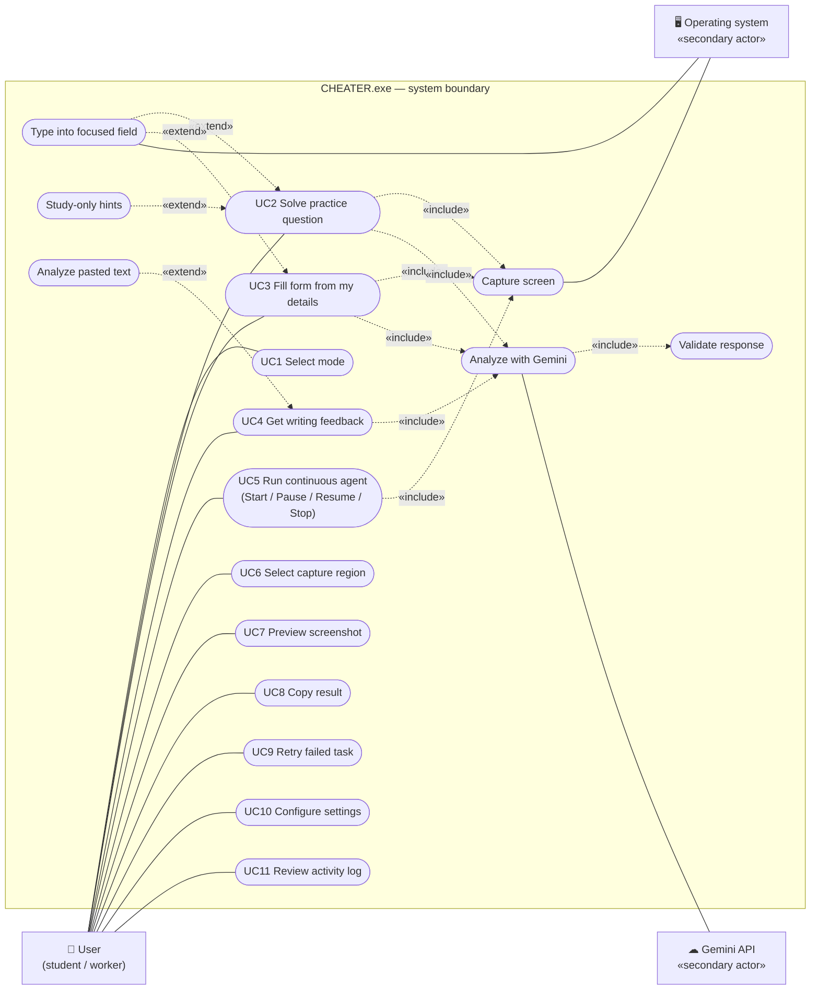

# 3. Use Cases

## 3.1 UML use case diagram

Mermaid has no native use-case syntax, so this follows UML notation: the actors are outside the system boundary, the use cases are ovals (stadium shapes), and `«include»` / `«extend»` are labelled dashed arrows.

## 3.2 Use case summary

| ID | Use case | Primary flow | Key alternate / exception flows |
|---|---|---|---|
| UC2 | Solve practice question | Capture Once → question, options, suggested answer, explanation, confidence | No question found. Study-only shows a hint, no answer. Graded exam suspected disables answer entry. Low confidence shows a warning. |
| UC3 | Fill form from my details | Type details → Capture → review rows (pre-ticked only if confident and user-sourced) → confirm → 3 s countdown → paste + Tab | Sensitive field (password, card, ID) is never filled. Invented personal value is removed. Non-text field stops the sequence. Focus lost or the app focused itself aborts. Stop or mouse in a corner aborts (fail-safe). |
| UC4 | Get writing feedback | Paste text → Analyze, or capture → feedback + improved version → Copy | No readable text: ask for paste or a clearer region |
| UC5 | Run continuous agent | Start → send the current screen → only meaningful changes, at most one request every 20 s | Unchanged screen is not sent. A 429 blocks requests until reset and pauses. Budget reached pauses. Stop discards in-flight results. |
| UC9 | Retry failed task | Re-send the in-memory last payload | Refused locally while a quota block is active or the budget is used up |
| UC10 | Configure settings | Edit interval, sensitivity, settle time, image size, timeout, retries, request gap, budget → saved to `settings.json` | Invalid numbers are rejected. Values are clamped to safe ranges. |
