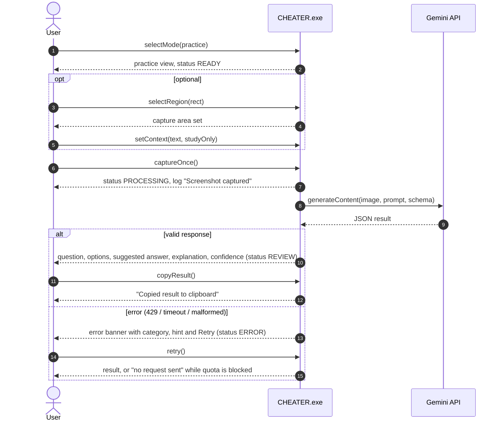
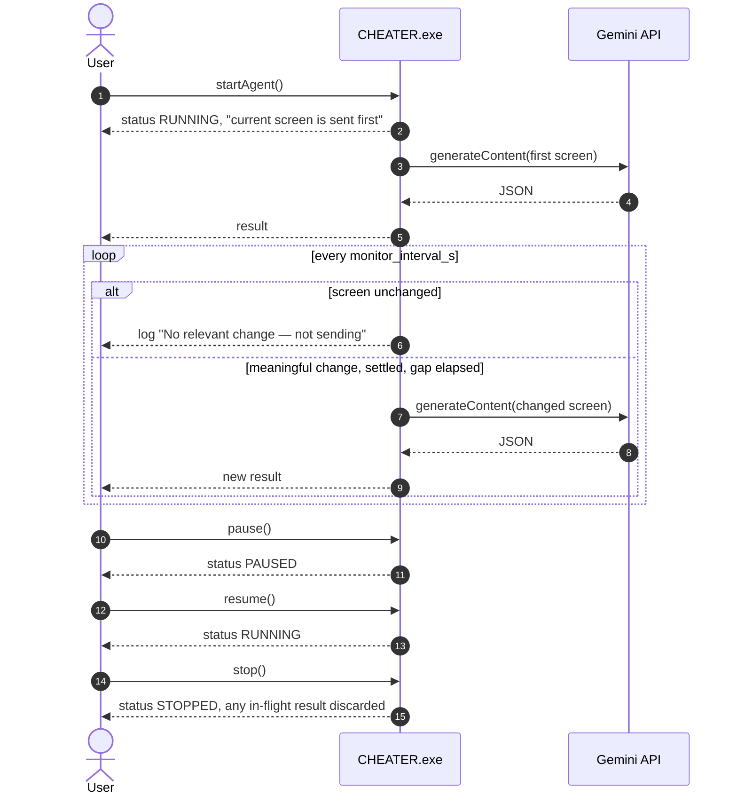
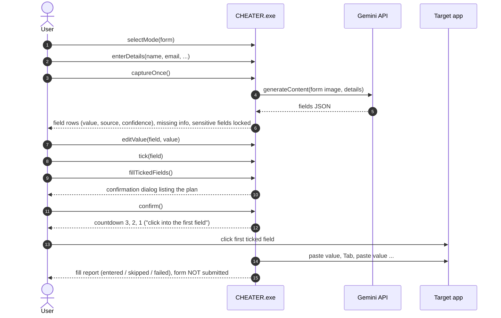
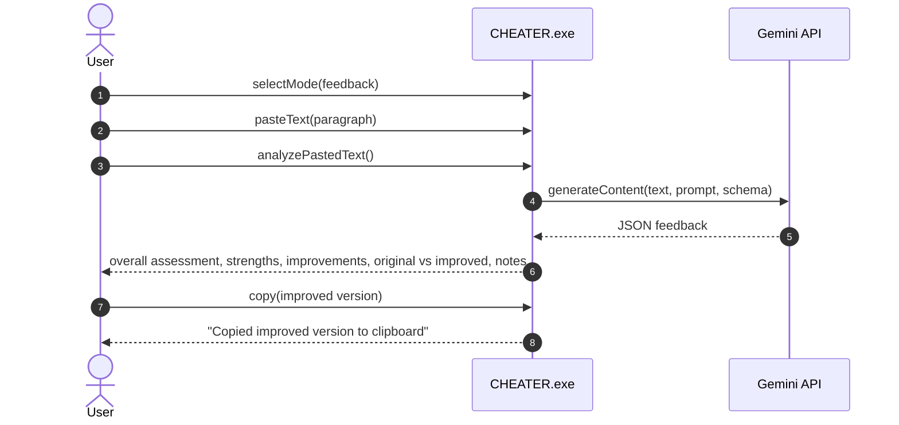

# 4. System Sequence Diagrams (SSD)

An SSD treats **CHEATER.exe as a black box**. It shows only the system events that actors send and the responses they get back. The internals are in [Sequence Diagrams](05-sequence-diagrams.md).

## 4.1 SSD — Solve a practice question (Capture Once)

## 4.2 SSD — Continuous monitoring

## 4.3 SSD — Fill a form

## 4.4 SSD — Feedback on pasted text

