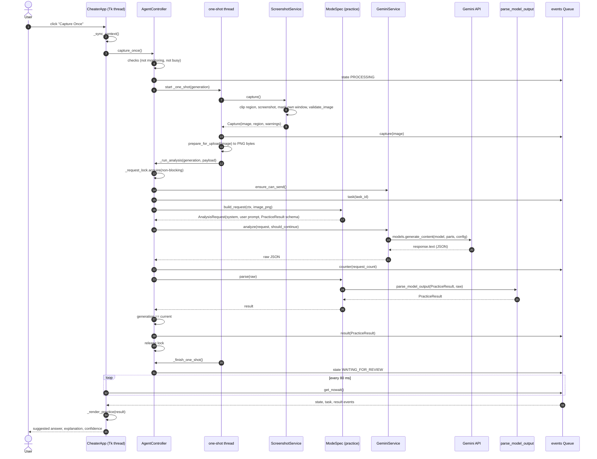
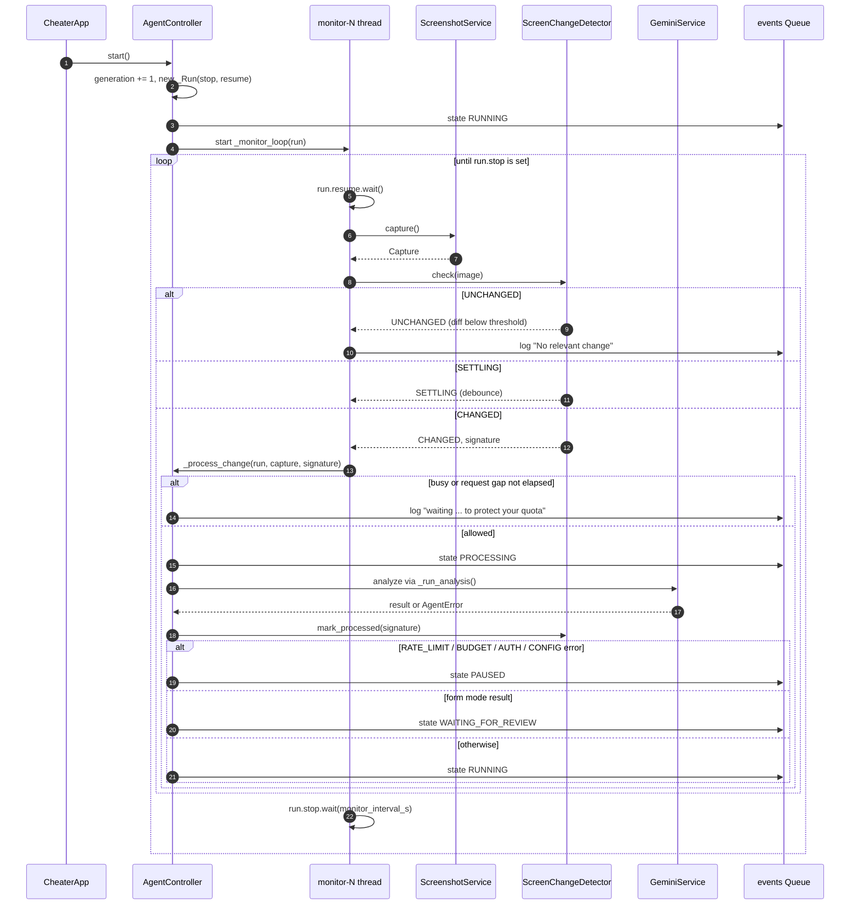
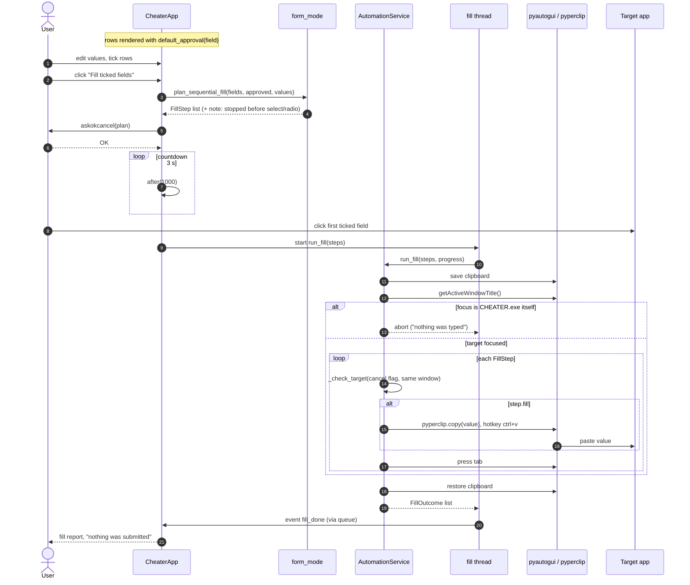
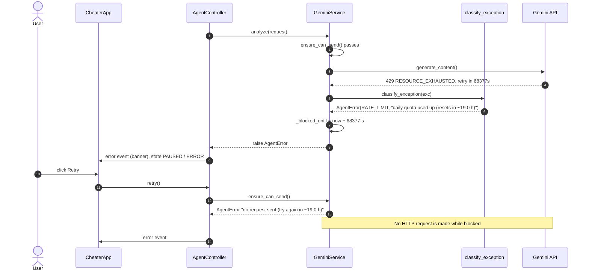
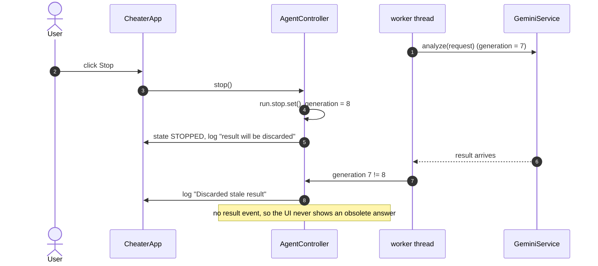

# 5. Sequence Diagrams (SD)

These are object-level interactions. The names are the real classes and methods in `app/`. Messages crossing from a worker thread to the UI always go through the `events` queue.

## 5.1 SD — Capture Once (practice mode)

## 5.2 SD — Continuous monitoring loop

## 5.3 SD — Reviewed form fill

## 5.4 SD — Rate-limit (429) handling and quota block

## 5.5 SD — Stop while a request is in flight (stale result)

