# 7. State Machine — `AgentState`

`AgentController._transition()` only allows the transitions listed in `TRANSITIONS`. Any other move is logged as "Ignored invalid state change" and has no effect.

```mermaid
stateDiagram-v2
    [*] --> IDLE

    state "Agent session" as SESSION {
        IDLE --> PROCESSING : capture_once() / analyze_text()
        IDLE --> RUNNING : start()

        RUNNING --> PROCESSING : change detected + gap elapsed
        PROCESSING --> RUNNING : result (continuous)

        RUNNING --> PAUSED : pause() / 3 screenshot failures
        PROCESSING --> PAUSED : pause() / quota, budget, auth error
        PAUSED --> RUNNING : resume()
        PAUSED --> PROCESSING : capture_once() while paused

        PROCESSING --> WAITING_FOR_REVIEW : result (one-shot / form mode)
        WAITING_FOR_REVIEW --> RUNNING : resume() / start()
        WAITING_FOR_REVIEW --> PROCESSING : capture_once() / retry()
        WAITING_FOR_REVIEW --> IDLE : clear() / set_mode()

        PROCESSING --> ERROR : one-shot failure
        ERROR --> PROCESSING : retry()
        ERROR --> IDLE : clear() / set_mode()
    }

    SESSION --> STOPPED : stop() from any state
    STOPPED --> SESSION : start() / capture_once() / clear()

    note right of SESSION
        PROCESSING: one request at a time (_request_lock).
        Results are shown only if their generation still
        matches. PAUSED: no captures; an in-flight result
        is still displayed.
    end note
```

The diagram shows the meaningful transitions. The table below lists **every** transition `TRANSITIONS` allows.

## Transition table

| From \ To | IDLE | RUNNING | PAUSED | PROCESSING | WAITING_FOR_REVIEW | ERROR | STOPPED |
|---|---|---|---|---|---|---|---|
| **IDLE** | – | ✓ | | ✓ | | | ✓ |
| **RUNNING** | | – | ✓ | ✓ | | ✓ | ✓ |
| **PAUSED** | ✓ | ✓ | – | ✓ | | | ✓ |
| **PROCESSING** | ✓ | ✓ | ✓ | – | ✓ | ✓ | ✓ |
| **WAITING_FOR_REVIEW** | ✓ | ✓ | ✓ | ✓ | – | | ✓ |
| **ERROR** | ✓ | ✓ | | ✓ | | – | ✓ |
| **STOPPED** | ✓ | ✓ | | ✓ | | | – |

UI status labels (`theme.STATUS_LABELS`): IDLE → **READY**, WAITING_FOR_REVIEW → **REVIEW**. The other states display their own names.
