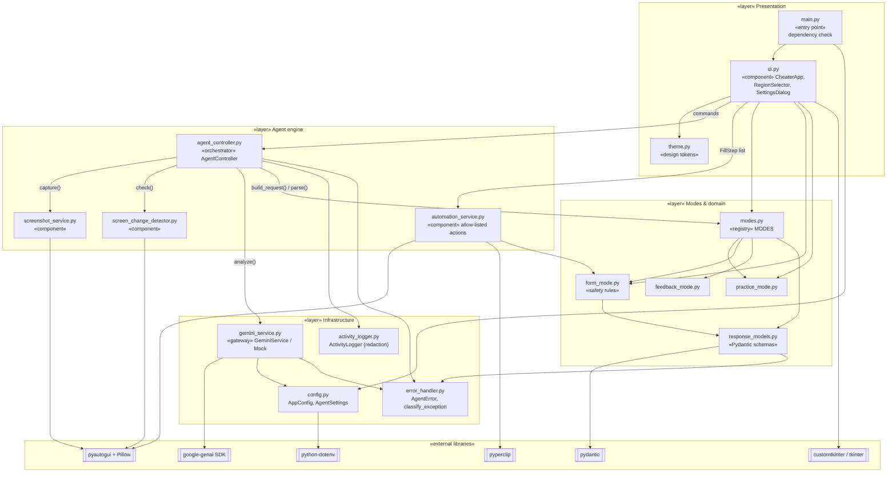
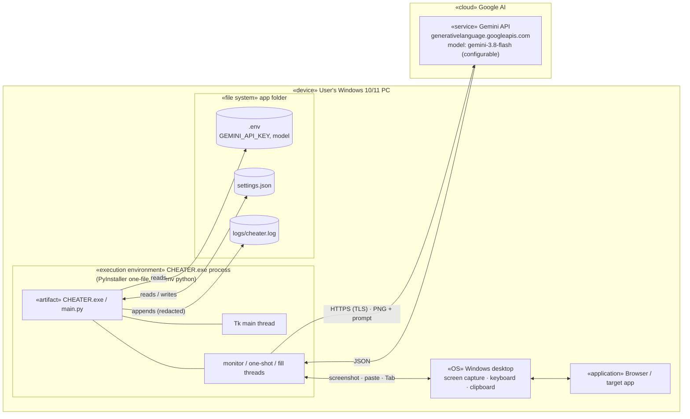

# 9. Component & Deployment Diagrams

## 9.1 UML component diagram

The components are the Python modules. Interfaces are shown as the main calls between them. Arrows point from the consumer to the provider.

## 9.2 UML deployment diagram

### Deployment options

| Option | Artifact | Python on target? | Config location |
|---|---|---|---|
| Launcher | `run.bat` → `.venv\Scripts\pythonw.exe main.py` | Yes (auto-creates venv) | Project folder |
| Standalone | `dist\CHEATER.exe` built by `build_exe.bat` (PyInstaller `--onefile --windowed`) | No | Folder next to the exe |

## 9.3 Package dependency rules

- `ui.py` is the only module that imports `customtkinter`.
- `agent_controller.py` never imports `ui.py`. It talks to the UI only through `AgentEvent`s.
- `gemini_service.py` is the only module that talks to the network.
- `automation_service.py` is the only module that sends keystrokes or touches the clipboard.
- There are no circular imports. The dependency direction is Presentation → Engine → Domain → Infrastructure.
